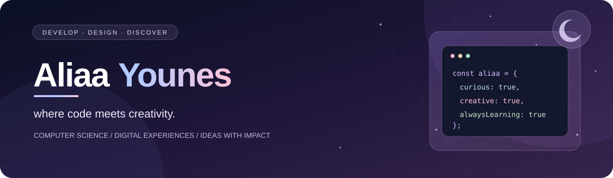

<div align="center">



### Hey, I'm Aliaa! ✨

**Computer Science Student · Developer · Digital Marketer**

I love the space where **technology, creativity, and real-world problems** meet.
Whether I'm working on an app, exploring an AI idea, or designing a digital experience, I want the result to be both **useful and beautiful**.

[**🌐 Explore my portfolio**](https://aliaayounes22-crypto.github.io) &nbsp; · &nbsp;
[**💼 LinkedIn**](https://www.linkedin.com/in/aliaa-younes-17608b389/) &nbsp; · &nbsp;
[**✉️ Say hello**](mailto:aliaayounes22@gmail.com)

</div>

---

### 🌷 A little about me

- 🎓 Studying **Computer Science at Egyptian Chinese University**.
- 💻 Interested in **software development, web experiences, and AI-powered ideas**.
- 📣 Exploring the creative side of tech through **digital marketing, Google Ads, and Meta Ads**.
- 🎨 I enjoy turning a rough idea into something people can actually interact with.
- 🐈 Outside of projects: **cats, classical music, and a good dose of curiosity**.

> **My kind of project:** something that solves a real problem *and* has a little personality.

### 🪄 Things I've been building

<table>
<tr>
<td width="50%" valign="top">

**🌙 [LunaPath](https://github.com/aliaayounes22-crypto/Lunapath-Nasa-App-Challenge)**

An interactive Moon landing-site exploration and planning prototype built for the **NASA Space Apps Challenge 2026**.

<sub>Space exploration · React · Interactive visualization</sub>

</td>
<td width="50%" valign="top">

**♻️ [EcoSort](https://github.com/aliaayounes22-crypto/ECOSORT)**

Interactive concepts that explore **smarter waste sorting** through thoughtful digital experiences.

<sub>Sustainability · Prototyping · UI</sub>

</td>
</tr>
<tr>
<td width="50%" valign="top">

**🩺 [CareID](https://github.com/aliaayounes22-crypto/CAREID)**

A digital-health identity and patient-experience concept with connected interface prototypes.

<sub>Health tech · Web design · User experience</sub>

</td>
<td width="50%" valign="top">

**🎓 [CGPA Calculator](https://github.com/aliaayounes22-crypto/CodeAlpha_CGPACalculator)**

A practical **C++ calculator** for academic grades and CGPA.

<sub>C++ · Problem solving · Student tools</sub>

</td>
</tr>
</table>

### 🧩 My creative toolkit

**Code & web**


**Design & digital marketing**


### 🚀 What keeps me curious

```text
BUILD   → turn ideas into working experiences
LEARN   → keep improving my technical skills
DESIGN  → make useful things feel effortless
CREATE  → leave room for a little imagination
```

<div align="center">

---

*I believe the best ideas are the ones you're brave enough to try.*

**Thanks for stopping by! 🌙**

[Portfolio](https://aliaayounes22-crypto.github.io) · [LinkedIn](https://www.linkedin.com/in/aliaa-younes-17608b389/)

</div>
